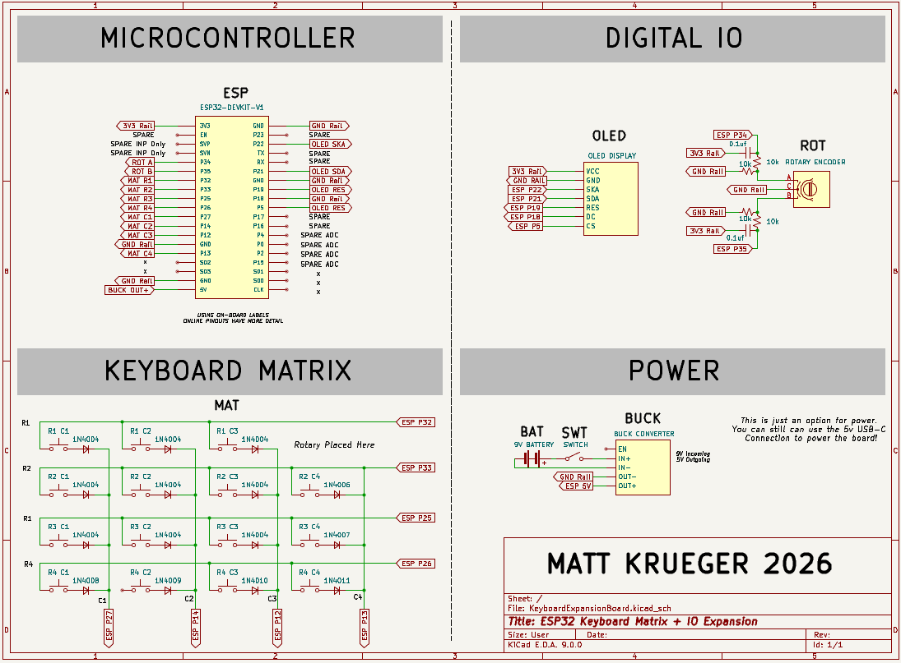
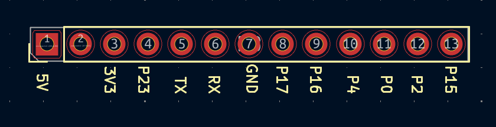
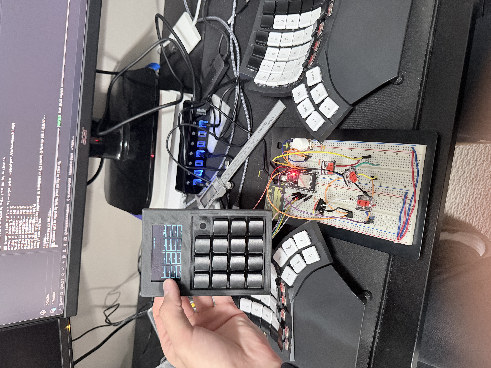

# Keyboard & ESP32 Expansion Board

This project includes the creation of the following:
- ESP32 Keyboard CAD design using Fusion360
- 2-Layer PCB designed using KiCad
- Firmware (agentically developed using Claude Code)

The intention for this was to create a starting point for controlling future projects (ex Stereo Camera Pan/Tilt Machine) by having a programmable keyboard and ability to add other periferals.

# Features
- OLED Display
- 15 Keys
- 1 Rotary Dial
- 20 port GPIO and power expansion 
- USB-C Power

# Schematic 

# Expansion Pinout

With the expansion unit, you are able to gain access to all remaining pins on the ESP32 without opening up the keyboard container. Pins were separated into categories of functionality.

# PCB (in progress)
Image not added yet

# CAD Design (in progress)
Image not added yet

# Current Progress (Testing before PCB creation)

# BOM & Cost

| Qty Used | Part | Link | Pack Price | Unit Cost | Cost Used |
|----------|------|------|-----------|-----------|-----------|
| 1 | 2.42" 128x64 OLED LCD Display (SSD1309) | [Amazon](https://www.amazon.com/Teyleten-Robot-Display-SSD1309-Interface/dp/B09LND6QJ1) | $13.00 / 1 | $13.00 | $13.00 |
| 1 | Rotary Dial (from Arduino kit) | N/A | $0.00 | $0.00 | $0.00 |
| 15 | Kailh Choc Keyswitches | [Amazon](https://www.amazon.com/Choc-Profile-White-Switches-Pre-lubed/dp/B0D49HD77G) | $13.00 / 20 | $0.65 | $9.75 |
| 1 | ESP32s 38-Pin Dev Board | [Amazon](https://www.amazon.com/hiBCTR-Development-Learning-Microcontroller-Programming/dp/B0DSZBH9N9) | $30.00 / 6 | $5.00 | $5.00 |
| - | 3D Filament (Matte Black) | N/A | N/A | N/A | $10.00 |

**Total:** $37.75

**This is not counting the assortment of resistors (10k), capacitors (0.1uf), diodes (1N4148), and which can be purchased in bulk for a negligible price**
