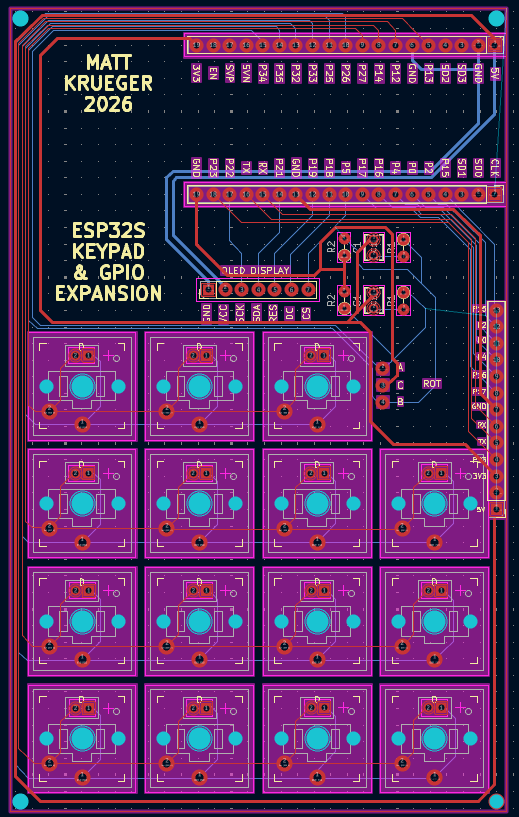
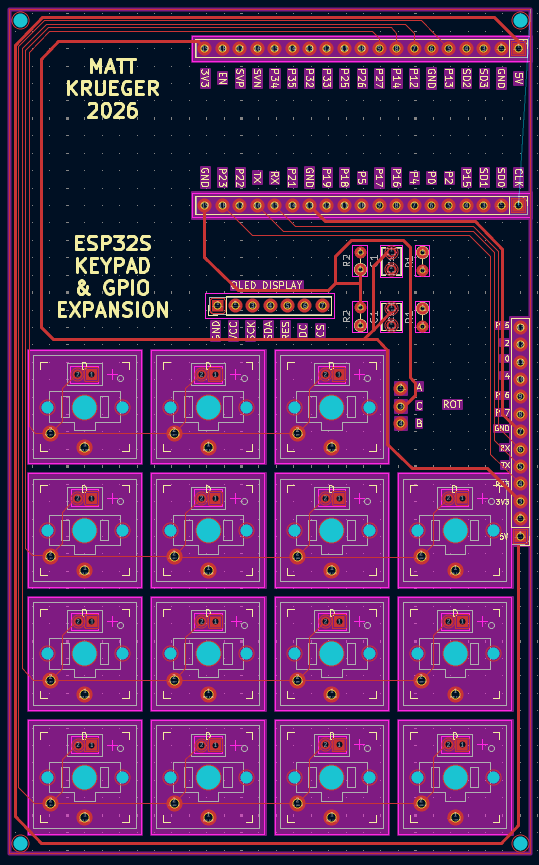
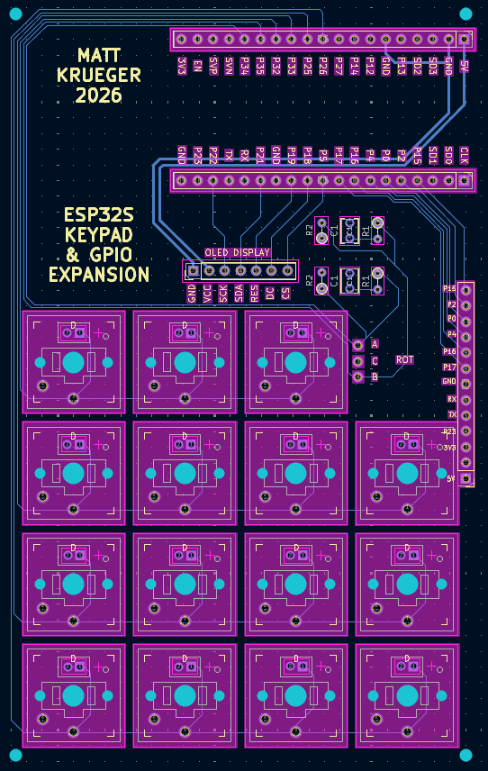

# Keyboard & ESP32 Expansion Board

This project includes the creation of the following:
- ESP32 Keyboard CAD design using Fusion360
- 2-Layer PCB designed using KiCad
- Firmware (agentically developed using Claude Code)

The intention for this was to create a starting point for controlling future projects (ex Stereo Camera Pan/Tilt Machine) by having a programmable keyboard and ability to add other periferals.

# Features
- OLED Display
- 15 Keys
- 1 Rotary Dial
- 20 port GPIO and power expansion 
- USB-C Power

# Schematic 

THIS SCHEMATIC WILL BE REDLINED SOON !!! 

# Expansion Pinout

# PCB (in progress)

Full PCB

Top Layer

Bottom Layer

Two layer PCB board created for the keypad. This has not been ordered yet as I am testing the layout within CAD. Expecting to order on friday 11/13/2026 after verifying the CAD model placement and traces.

# CAD Design (in progress)
Image not added yet

# Current Progress (Testing before PCB creation)

# BOM & Cost

| Qty Used | Part | Link | Pack Price | Unit Cost | Cost Used |
|----------|------|------|-----------|-----------|-----------|
| 1 | 2.42" 128x64 OLED LCD Display (SSD1309) | [Amazon](https://www.amazon.com/Teyleten-Robot-Display-SSD1309-Interface/dp/B09LND6QJ1) | $13.00 / 1 | $13.00 | $13.00 |
| 1 | Rotary Dial (from Arduino kit) | N/A | $0.00 | $0.00 | $0.00 |
| 15 | Kailh Choc Keyswitches | [Amazon](https://www.amazon.com/Choc-Profile-White-Switches-Pre-lubed/dp/B0D49HD77G) | $13.00 / 20 | $0.65 | $9.75 |
| 1 | ESP32s 38-Pin Dev Board | [Amazon](https://www.amazon.com/hiBCTR-Development-Learning-Microcontroller-Programming/dp/B0DSZBH9N9) | $30.00 / 6 | $5.00 | $5.00 |
| 1 | PCB | N/A | ? | ? | ? |
| - | 3D Filament (Matte Black) | N/A | N/A | N/A | ? |

**Total:** not sure yet

**This is not counting the assortment of resistors (10k), capacitors (0.1uf), and diodes (1N4148) which can be purchased in bulk for a negligible price. Additionally, the keycaps are not included as they can be 3d printed or purchased (using spares for this project)**
